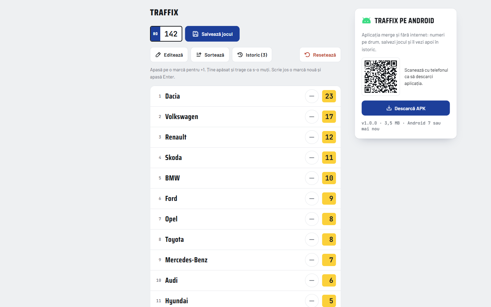
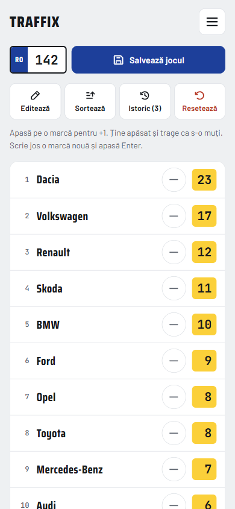

<div align="center">

# Traffix

**Count the cars you pass, brand by brand.**<br>
Tap a brand, the number goes up. Save the game, and next time the brands you see most are already on top.

[](https://github.com/rafail3/traffix/actions/workflows/ci.yml)
[](https://github.com/rafail3/traffix/releases/latest)
[](https://github.com/rafail3/traffix/releases/latest/download/traffix.apk)

[**Open the web app**](https://traffix-rafa.vercel.app) · [**Download the APK**](https://github.com/rafail3/traffix/releases/latest/download/traffix.apk) · [Contribute](CONTRIBUTING.md)

<br>


&nbsp;


</div>

<br>

## What it does

- **Count.** One tap per car. Long-press and drag to reorder; edit the list any time.
- **Save.** Name a game and keep it. Every saved game stays in your history.
- **Learn.** The list re-orders itself from your saved games. No brand ever disappears; only the order changes.
- **Offline.** Everything stays on your device. The Android app works without internet.

## Run it locally

Requires Node 24 or newer.

```bash
npm ci
npm run dev      # http://localhost:3000
npm test         # ranking tests
```

## How it is built

| Part | Built with |
| --- | --- |
| App | [Next.js](https://nextjs.org) + React, plain CSS |
| Android | The same app packaged with [Capacitor](https://capacitorjs.com) |
| Storage | `localStorage`, one profile per device |
| Ranking | A Bradley–Terry style model over saved games, recent games weigh more (`lib/rank.ts`) |
| Releases | [semantic-release](https://semantic-release.gitbook.io) from pull request titles; each release ships a signed APK |

```text
app/        screens and styles
lib/        brands, ranking, storage (with tests)
android/    Capacitor Android project
.github/    CI, release and pull request checks
```

## Contributing

Pull requests are welcome. Start with [CONTRIBUTING.md](CONTRIBUTING.md); it takes two minutes to read.
Found a security issue? Please report it privately, see [SECURITY.md](SECURITY.md).
